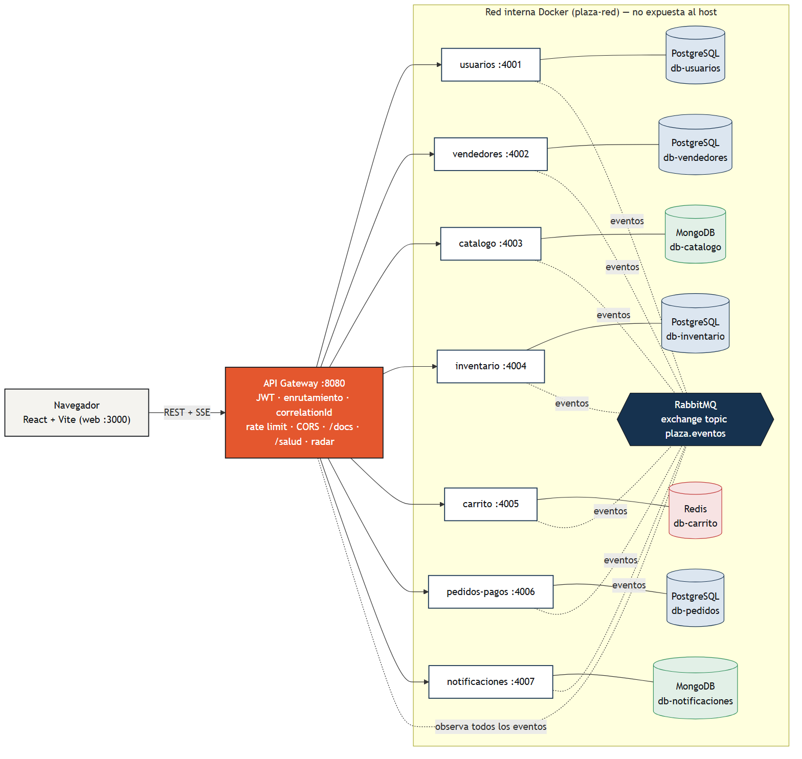

# Plaza Sinú

Marketplace multivendedor de Córdoba (Colombia) construido con **arquitectura de microservicios**. Los puestos de Montería, Cereté, Lorica, Sahagún y Tierralta publican sus productos, y los clientes compran a varios puestos en un solo carrito. Cada compra atraviesa siete servicios independientes, unidos por un API Gateway, REST y eventos de RabbitMQ.

| | |
|---|---|
| **Integrantes** | David Cuello · Miguel Miranda |
| **Curso** | Optativa I — Arquitectura de Microservicios (Proyecto Final, enunciado n.º 2 "Marketplace de Comercio Electrónico") |
| **Universidad** | Universidad Cooperativa de Colombia, sede Montería — Ingeniería de Sistemas |
| **Docente** | Maria Claudia |

> **Demo en línea:** https://plaza-sinu.vercel.app (cliente `cliente@plazasinu.co` / `Demo123*`)

> **¿Es docente y evalúa el proyecto?** Empiece por la [matriz de cumplimiento](docs/matriz-cumplimiento.md): cada requisito y entregable del enunciado con el archivo o la evidencia que lo demuestra.



## Microservicios

| Servicio | Responsabilidad | Puerto | Base de datos | Publica | Consume |
|---|---|---|---|---|---|
| **gateway** | Punto de entrada único: enruta, valida el JWT, propaga el `correlationId`, limita intentos de login, agrega los Swagger, salud y monitor de eventos | 8080 | — | — | Todos los eventos (solo para el Radar) |
| **usuarios** | Registro, login, refresh rotativo, perfil y roles | 4001 | PostgreSQL | `usuario.registrado` | — |
| **vendedores** | Solicitud y aprobación de puestos | 4002 | PostgreSQL | `vendedor.aprobado`, `vendedor.suspendido` | — |
| **catalogo** | Productos con atributos por categoría, búsqueda y filtros | 4003 | MongoDB | `producto.publicado` | `inventario.actualizado`, `vendedor.aprobado`, `vendedor.suspendido` |
| **inventario** | Stock, reservas con vencimiento y kardex | 4004 | PostgreSQL | `inventario.actualizado`, `inventario.stock_bajo`, `reserva.confirmada`, `reserva.liberada` | `pago.aprobado`, `pago.rechazado`, `producto.publicado` |
| **carrito** | Carrito por cliente agrupado por vendedor | 4005 | Redis | — | `pago.aprobado` |
| **pedidos-pagos** | Saga de compra orquestada, pasarela simulada y traza del pedido | 4006 | PostgreSQL | `pedido.creado`, `pago.aprobado`, `pago.rechazado`, `pedido.estado_cambiado` | `reserva.confirmada`, `reserva.liberada`, `notificacion.enviada` |
| **notificaciones** | Notificaciones en vivo (SSE) y correo simulado | 4007 | MongoDB | `notificacion.enviada` | `usuario.registrado`, `vendedor.*`, `pedido.creado`, `pago.*`, `pedido.estado_cambiado`, `inventario.stock_bajo` |
| **web** | Frontend React servido por NGINX | 3000 | — | — | — |

En total son **17 contenedores**: los 7 servicios, el gateway, el web, RabbitMQ y 7 bases de datos (una por servicio). Solo se publican al host la web (3000), el gateway (8080) y el panel de RabbitMQ (15672). Los servicios y las bases viven en la red interna `plaza-red`.

## Stack tecnológico

| Pieza | Tecnología |
|---|---|
| Servicios y gateway | Node.js 22 + Express 5 (ES Modules), zod, pino, helmet, express-rate-limit, http-proxy-middleware |
| Bases de datos | PostgreSQL 16 + Prisma 6 · MongoDB 7 + Mongoose · Redis 7 + ioredis |
| Mensajería | RabbitMQ 3.13 (exchange topic `plaza.eventos`, colas durables y DLQ) |
| Seguridad | JWT HS256 (15 min) + refresh token rotativo (7 días), bcrypt, clave interna entre servicios |
| Frontend | React + Vite + React Router, NGINX |
| Documentación de APIs | OpenAPI 3 + Swagger UI (agregado en el gateway) |
| Pruebas | Jest + Supertest, scripts E2E en Node, Playwright |
| Contenedores | Docker multi-etapa (`node:22-alpine`, usuario no root) + Docker Compose |

El porqué de cada decisión está en [`docs/decisiones-tecnicas.md`](docs/decisiones-tecnicas.md).

## Requisitos previos

| Para | Necesitas |
|---|---|
| Levantar la solución | **Docker Desktop** con al menos 4 GB de RAM asignados (los 17 contenedores usan menos de 1 GB en reposo), y Git |
| Correr las pruebas o desarrollar | **Node.js 22** y npm |

## Instalación paso a paso (PowerShell)

```powershell
git clone https://github.com/davidcuello0523-ctrl/plaza-sinu.git
cd plaza-sinu
Copy-Item .env.example .env
docker compose up --build
```

La primera vez tarda unos minutos porque construye las imágenes. Está listo cuando `docker compose ps` muestra los 17 contenedores como `healthy`.

También puedes usar el script, que copia `.env` si falta, levanta todo y espera a que el gateway responda:

```powershell
powershell -ExecutionPolicy Bypass -File scripts/levantar.ps1
powershell -ExecutionPolicy Bypass -File scripts/levantar.ps1 -Limpio
```

`-Limpio` borra antes los volúmenes y vuelve a sembrar los datos de demostración.

## URLs

| Qué | URL | Credenciales |
|---|---|---|
| Aplicación web | http://localhost:3000 | Usuarios de demo (abajo) |
| Modo sustentación | http://localhost:3000/?demo=1 | — |
| API Gateway | http://localhost:8080 | JWT |
| Swagger agregado (7 servicios) | http://localhost:8080/docs | Botón *Authorize* con el JWT |
| Salud de todos los servicios | http://localhost:8080/salud | — |
| Panel de RabbitMQ | http://localhost:15672 | `plaza` / `plaza` (valores de `.env.example`) |

## Usuarios de demostración

Todos usan la clave **`Demo123*`**.

| Rol | Correo | Nombre | Para qué sirve |
|---|---|---|---|
| Cliente | `cliente@plazasinu.co` | Laura Petro | Comprar, ver pedidos y notificaciones |
| Cliente | `cliente2@plazasinu.co` … `cliente4@plazasinu.co` | Andrés Doria, Valentina Hoyos, Camilo Negrete | Otros clientes con pedidos históricos |
| Vendedor | `vendedor@plazasinu.co` | Mario Arrieta (Tecno Sinú) | Mi Puesto: productos, inventario y sub-pedidos |
| Vendedor | `bicis@`, `ropa@`, `hogar@`, `artesanias@`, `papeleria@`, `deportes@plazasinu.co` | Un puesto aprobado cada uno | Otros puestos |
| Vendedor | `pendiente@plazasinu.co` | Pedro Banda (Mercadito Tierralta) | Puesto **pendiente** de aprobación |
| Admin | `admin@plazasinu.co` | Administración Plaza Sinú | Sala de Máquinas |

La cuenta de administrador `pacho@plazasinu.co` solo se crea si en `.env` se define `CLAVE_ADMIN_PACHO`. Su clave no está en el repositorio.

### Tarjetas de prueba (pasarela simulada)

| Número | Resultado |
|---|---|
| `4242 4242 4242 4242` | Pago **aprobado** |
| `4000 0000 0000 0002` | Pago **rechazado** ("Fondos insuficientes") |

Cualquier titular, vencimiento futuro (`MM/AA`) y CVV de 3 dígitos. Solo se guardan la marca y los últimos 4 dígitos.

## Demo del flujo obligatorio en 2 minutos

Flujo del enunciado: **iniciar sesión → consultar productos → agregar al carrito → generar pedido → actualizar inventario → registrar pago → generar notificación.**

1. Abre http://localhost:3000/?demo=1. Aparece el panel **Modo sustentación**, que marca solo cada uno de los 7 pasos cuando ocurre.
2. Entra con `cliente@plazasinu.co` / `Demo123*`.
3. Abre el **Catálogo**, elige un producto y pulsa **Agregar al carrito**.
4. Ve al carrito, pulsa **Continuar con la compra**, llena teléfono y dirección y pulsa **Reservar y continuar al pago**. Inventario aparta las unidades por 15 minutos.
5. Toca la tarjeta **4242** y pulsa **Pagar**.
6. En la página del pedido mira la **Traza del pedido**: cada servicio que participó, si fue REST o evento, y el `correlationId`. La campana muestra la notificación.
7. En otra pestaña entra como `admin@plazasinu.co` y abre la **Sala de Máquinas**: Mapa de servicios en vivo y Radar de eventos.

Para seguir la misma compra en los logs:

```powershell
docker compose logs --no-log-prefix | Select-String "<correlationId>"
```

## Pruebas

| Comando | Qué corre | Último resultado |
|---|---|---|
| `npm install` y luego `npm test` | Jest + Supertest en los 8 paquetes | **147/147** |
| `npm run e2e` | Flujo obligatorio completo contra Docker | **24/24** |
| `npm run resiliencia` | Servicios caídos, concurrencia y tokens | **11/11** |
| `npx playwright install chromium` y luego `npm run ui` | Flujo obligatorio en el navegador | **1/1** |
| `npm run evidencias` | La prueba de UI más las capturas y `docker-ps.txt` | 29 capturas |

Detalle en el [plan de pruebas](docs/pruebas/plan-de-pruebas.md).

## Estructura del repositorio

```text
plaza-sinu/
├── compartido/             Librería técnica común (@plaza/compartido): logger, errores, JWT,
│                           validación, cliente HTTP interno y bus RabbitMQ. Sin modelos de dominio
├── gateway/                API Gateway: rutas, JWT, rate limit, Swagger agregado, salud y monitor
├── servicios/
│   ├── usuarios/           Cada servicio tiene: src/ (rutas → controladores → servicios →
│   ├── vendedores/         repositorio, eventos, clientes), tests/, openapi.yaml, Dockerfile
│   ├── catalogo/           y, si usa Postgres, prisma/schema.prisma
│   ├── inventario/
│   ├── carrito/
│   ├── pedidos-pagos/
│   └── notificaciones/
├── web/                    Frontend React + Vite (La Plaza, Mi Puesto, Sala de Máquinas) y NGINX
├── pruebas/
│   ├── e2e/                Flujo obligatorio y resiliencia contra Docker
│   └── ui/                 Prueba de Playwright
├── scripts/levantar.ps1    Arranque en Windows
├── docs/                   Documentación (índice abajo)
├── docker-compose.yaml     Los 17 contenedores
├── .env.example            Variables de entorno de ejemplo
└── playwright.config.mjs
```

## Documentación

| Documento | Contenido |
|---|---|
| [Informe del proyecto (PDF)](docs/informe/Informe_Plaza_Sinu_Cuello_Miranda.pdf) · [Word](docs/informe/Informe_Plaza_Sinu_Cuello_Miranda.docx) | Informe final para la entrega |
| [Matriz de cumplimiento](docs/matriz-cumplimiento.md) | Cada requisito y entregable con su evidencia |
| [Decisiones técnicas](docs/decisiones-tecnicas.md) | Tecnologías y 15 ADR |
| [Contratos entre servicios](docs/contratos.md) | Convenciones, rutas internas, eventos y datos de demo |
| [Arquitectura general](docs/arquitectura/01-arquitectura-general.png) | Diagrama general ([fuente](docs/arquitectura/01-arquitectura-general.mmd)) |
| [Comunicación entre servicios](docs/arquitectura/02-comunicacion.png) | REST y eventos ([fuente](docs/arquitectura/02-comunicacion.mmd)) |
| [Secuencia de compra](docs/arquitectura/03-secuencia-compra.png) | Flujo obligatorio paso a paso |
| [Secuencia de pago rechazado](docs/arquitectura/04-secuencia-pago-rechazado.png) | Compensación |
| [Modelos de datos](docs/modelos-datos/README.md) | Un archivo por servicio con diagrama ER |
| [Manual de instalación y usuario](docs/manual-instalacion-usuario.md) | Instalación y uso por rol |
| [Plan de pruebas](docs/pruebas/plan-de-pruebas.md) | Tipos, criterios, casos y resultados |
| [Resultados E2E](docs/pruebas/resultados-e2e.md) · [Resiliencia](docs/pruebas/resultados-resiliencia.md) | Salidas de la última ejecución |
| [Evidencias](docs/evidencias/) | Capturas numeradas y `docker-ps.txt` |
| [Guion de sustentación](docs/sustentacion/guion.md) | 10 etapas, tiempos y reparto |
| [Preguntas probables](docs/sustentacion/preguntas-probables.md) | Respuestas con el archivo que las respalda |
| [Checklist de la demo](docs/sustentacion/checklist-demo.md) | Lista para el día de la sustentación |
| [Créditos de imágenes](docs/creditos-imagenes.md) | Autor y licencia de las fotos de productos (Wikimedia Commons) |
| [Cómo contribuir](CONTRIBUTING.md) | Ramas, commits y pruebas |
| Swagger | http://localhost:8080/docs con la solución arriba, o `servicios/*/openapi.yaml` |

## Problemas frecuentes

| Síntoma | Solución |
|---|---|
| `port is already allocated` (3000, 8080 o 15672) | Otro programa usa el puerto. Ciérralo, o busca cuál es con `Get-NetTCPConnection -LocalPort 8080` |
| Contenedores que se reinician o quedan `unhealthy` | Poca RAM. En Docker Desktop → *Settings* → *Resources* sube la memoria a 4 GB o más y cierra otros programas |
| `failed to connect to the docker API` | Docker Desktop no está abierto, o está pausado. Ábrelo y espera a que diga *Engine running* |
| Quiero volver a los datos iniciales | `docker compose down -v` y luego `docker compose up --build` (borra los volúmenes) |
| La web carga pero no hay productos | El gateway aún no está sano. Espera a que `docker compose ps` muestre todo `healthy` |
| `npm run ui` dice que falta el navegador | `npx playwright install chromium` |
