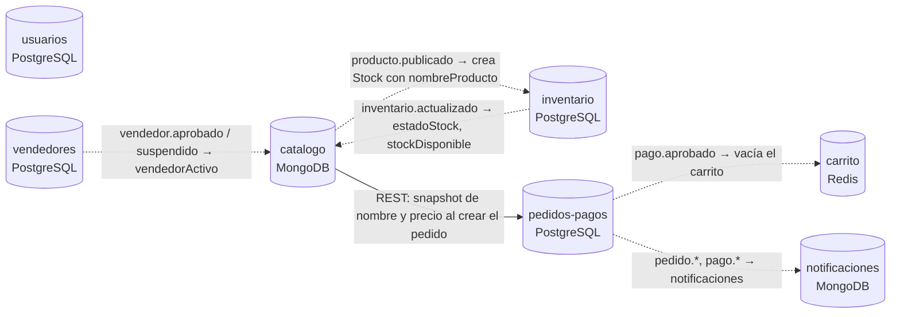

# Modelos de datos — vista general

Cada microservicio es **dueño de su base de datos**: corre en su propio contenedor, con su propio volumen y su propia cadena de conexión. Ningún servicio lee ni escribe la base de otro. No hay claves foráneas entre bases (ADR-03 en [`decisiones-tecnicas.md`](../decisiones-tecnicas.md)).

| Servicio | Motor | Contenedor | Colecciones / tablas | Modelo |
|---|---|---|---|---|
| usuarios | PostgreSQL 16 + Prisma | `db-usuarios` | `Usuario`, `RefreshToken` | [usuarios.md](usuarios.md) |
| vendedores | PostgreSQL 16 + Prisma | `db-vendedores` | `Vendedor` | [vendedores.md](vendedores.md) |
| catalogo | MongoDB 7 + Mongoose | `db-catalogo` | `productos`, `eventos_procesados` | [catalogo.md](catalogo.md) |
| inventario | PostgreSQL 16 + Prisma | `db-inventario` | `Stock`, `Reserva`, `ReservaItem`, `Movimiento`, `EventoProcesado` | [inventario.md](inventario.md) |
| carrito | Redis 7 + ioredis | `db-carrito` | claves `carrito:<usuarioId>`, `evento:procesado:<id>` | [carrito.md](carrito.md) |
| pedidos-pagos | PostgreSQL 16 + Prisma | `db-pedidos` | `Pedido`, `SubPedido`, `ItemPedido`, `Pago`, `PasoTraza`, `Contador`, `EventoProcesado` | [pedidos-pagos.md](pedidos-pagos.md) |
| notificaciones | MongoDB 7 + Mongoose | `db-notificaciones` | `notificaciones`, `correos`, `eventosProcesados` | [notificaciones.md](notificaciones.md) |

## Por qué cada motor

- **PostgreSQL** donde hay dinero, stock o identidad: hace falta integridad y **transacciones** (por ejemplo, `SELECT … FOR UPDATE` al reservar stock).
- **MongoDB** donde cada documento tiene una forma distinta: los atributos de un producto cambian según la categoría, y una notificación es un documento independiente.
- **Redis** para el carrito: es estado efímero, con lecturas muy rápidas y vencimiento automático (TTL de 7 días). Si se pierde, no se pierde dinero.

## Cómo se replican datos entre servicios

Los servicios no hacen *joins* entre bases. Si un servicio necesita un dato de otro, lo pide por **REST** o guarda una **copia local** que le llega por **eventos** de RabbitMQ.

| Dato copiado | Dueño | Copia en | Cómo llega |
|---|---|---|---|
| Vendedor activo o suspendido | vendedores | `productos.vendedorActivo` (catalogo) | Evento `vendedor.aprobado` / `vendedor.suspendido` |
| Estado de stock | inventario | `productos.estadoStock` y `stockDisponible` (catalogo) | Evento `inventario.actualizado` |
| Nombre del producto | catalogo | `Stock.nombreProducto` (inventario) | Evento `producto.publicado` |
| Nombre, precio, categoría e imagen al comprar | catalogo | `ItemPedido` (pedidos-pagos) | REST interno al crear el pedido (*snapshot*: el pedido no cambia si luego cambia el precio) |
| Nombre de la tienda | vendedores | `productos.nombreTienda`, `SubPedido.nombreTienda` | Se copia al publicar o al comprar |
| `usuarioId`, `clienteId`, `vendedorUsuarioId` | usuarios | Todos los servicios | Viene en el JWT (`sub`); nadie consulta la base de usuarios |

Los campos que apuntan a otro servicio (`usuarioId`, `productoId`, `vendedorId`, `pedidoId`) son **identificadores lógicos**, no claves foráneas. La integridad entre servicios es eventual y la cuidan los eventos.

## Idempotencia de los consumidores

Los servicios que consumen eventos guardan el `id` de cada evento procesado (`EventoProcesado` en Postgres, `eventos_procesados` o `eventosProcesados` en Mongo, `evento:procesado:<id>` en Redis). Si RabbitMQ entrega un evento dos veces, el segundo se ignora.
