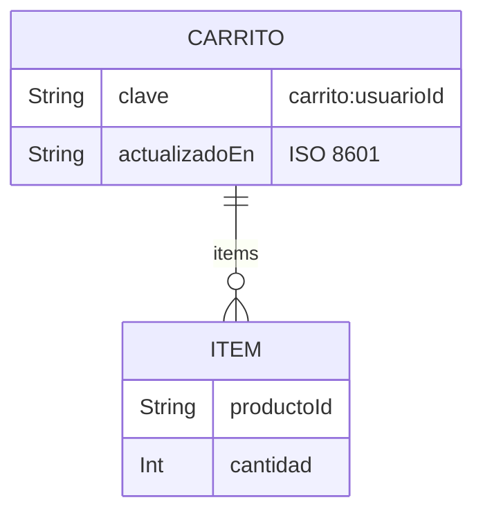

# carrito — modelo de datos

**Motor:** Redis 7 con ioredis · **Contenedor:** `db-carrito` · **Repositorio:** [`servicios/carrito/src/repositorio/carrito.repositorio.js`](../../servicios/carrito/src/repositorio/carrito.repositorio.js)

Redis es un almacén clave-valor: no hay tablas. Cada carrito es **una clave** con un JSON.

## Claves

| Clave | Valor | TTL | Descripción |
|---|---|---|---|
| `carrito:<usuarioId>` | JSON `{ items: [...], actualizadoEn }` | 7 días (604 800 s), se renueva en cada escritura | Carrito del cliente |
| `evento:procesado:<eventoId>` | `"1"` | 7 días | Marca de idempotencia del consumidor de `pago.aprobado` |

## Estructura del JSON del carrito

| Campo | Tipo | Descripción |
|---|---|---|
| `items[].productoId` | String | Producto del catálogo (id lógico) |
| `items[].cantidad` | Int | Unidades pedidas |
| `actualizadoEn` | String ISO 8601 | Última modificación |

El nombre, el precio, la tienda y la disponibilidad **no se guardan**: al leer el carrito, el servicio los pide por REST a catalogo e inventario y arma los grupos por vendedor. Así el cliente siempre ve el precio y el stock actuales.

## Justificación del motor

El carrito es estado efímero y se lee en casi cada pantalla. Redis responde en microsegundos y el TTL limpia solos los carritos abandonados. Si Redis se pierde, el cliente solo pierde su carrito, no dinero ni pedidos.

## Eventos

No publica eventos. Consume `pago.aprobado` en la cola `carrito.eventos` y vacía el carrito del cliente que pagó.
