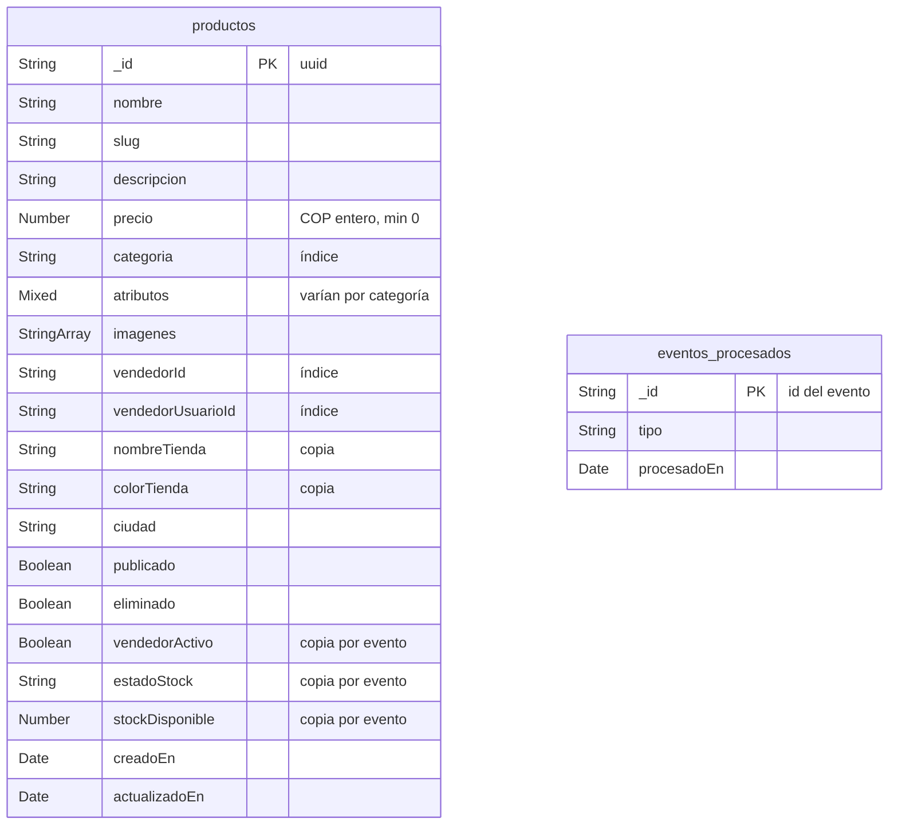

# catalogo — modelo de datos

**Motor:** MongoDB 7 con Mongoose · **Contenedor:** `db-catalogo` · **Modelo:** [`servicios/catalogo/src/modelos/producto.modelo.js`](../../servicios/catalogo/src/modelos/producto.modelo.js)

## Colección `productos`

| Campo | Tipo | Restricciones | Descripción |
|---|---|---|---|
| `_id` | String | uuid por defecto (el seed usa `prd-001` … `prd-048`) | Identificador (`productoId` en los demás servicios) |
| `nombre` | String | requerido, recortado | Nombre del producto |
| `slug` | String | requerido | Nombre en URL |
| `descripcion` | String | `""` por defecto | Descripción |
| `precio` | Number | requerido, ≥ 0 | Pesos colombianos enteros |
| `categoria` | String | requerido, índice | Slug de la categoría |
| `atributos` | Mixed | `{}` por defecto | Campos libres por categoría: rin y talla en bicicletas, voltaje en tecnología, número de vueltas en un sombrero vueltiao |
| `imagenes` | [String] | `[]` por defecto | Rutas de imagen (el servicio genera SVG en `/productos/:id/imagen.svg`) |
| `vendedorId` / `vendedorUsuarioId` | String | requeridos, índice | Dueño del producto (ids lógicos) |
| `nombreTienda` / `colorTienda` / `ciudad` | String | copia | Datos del puesto copiados al publicar para no consultar a vendedores en cada lectura |
| `publicado` | Boolean | `false` por defecto | Solo los publicados se ven en La Plaza |
| `eliminado` | Boolean | `false` por defecto | Borrado lógico |
| `vendedorActivo` | Boolean | `true` por defecto | Copia que llega por `vendedor.aprobado` / `vendedor.suspendido` |
| `estadoStock` | String | `disponible`, `ultimas_unidades` o `agotado` | Copia que llega por `inventario.actualizado` |
| `stockDisponible` | Number | 0 por defecto | Copia que llega por `inventario.actualizado` |
| `creadoEn` / `actualizadoEn` | Date | automáticos | `timestamps` de Mongoose |

**Índices:** `categoria`, `vendedorId`, `vendedorUsuarioId` y el compuesto `{ publicado, eliminado, vendedorActivo, creadoEn: -1 }` para la consulta principal de La Plaza.

## Colección `eventos_procesados`

Guarda el `id` de cada evento ya procesado para que el consumidor sea idempotente.

## Justificación del motor

Cada categoría tiene atributos distintos. En SQL habría que crear una tabla por categoría o usar EAV. En MongoDB, `atributos` es un subdocumento libre y los filtros por atributo siguen siendo consultas simples. El catálogo es el servicio más leído, y el documento ya trae todo lo que la tarjeta del producto necesita.

## Eventos

Publica `producto.publicado` (lo consume inventario). Consume `inventario.actualizado`, `vendedor.aprobado` y `vendedor.suspendido` en la cola `catalogo.eventos`.
