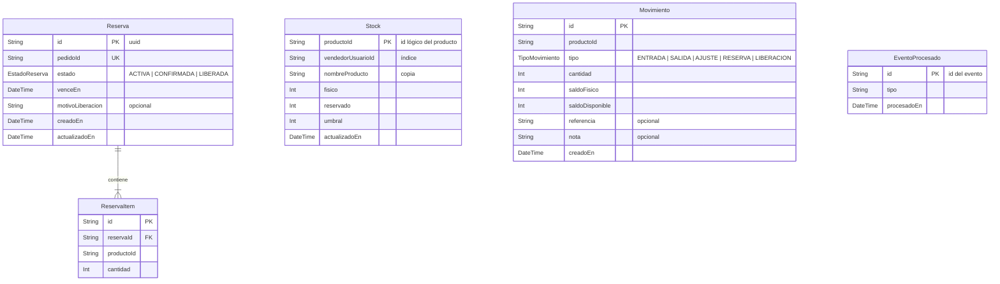

# inventario — modelo de datos

**Motor:** PostgreSQL 16 con Prisma 6 · **Contenedor:** `db-inventario` · **Esquema:** [`servicios/inventario/prisma/schema.prisma`](../../servicios/inventario/prisma/schema.prisma)

## Stock

| Campo | Tipo | Restricciones | Descripción |
|---|---|---|---|
| `productoId` | String | PK | Mismo id que el producto en catalogo (lógico, sin FK) |
| `vendedorUsuarioId` | String | opcional, índice | Dueño, para que el vendedor solo vea su stock |
| `nombreProducto` | String | opcional | Copia que llega por `producto.publicado` |
| `fisico` | Int | 0 por defecto | Unidades en bodega |
| `reservado` | Int | 0 por defecto | Unidades apartadas por pedidos sin pagar |
| `umbral` | Int | 3 por defecto | Bajo este disponible se emite `inventario.stock_bajo` |

**Disponible = `fisico − reservado`.** Estado: `agotado` si es 0, `ultimas_unidades` si es ≤ umbral y `disponible` en otro caso.

## Reserva y ReservaItem

| Campo | Tipo | Restricciones | Descripción |
|---|---|---|---|
| `Reserva.id` | String | PK | Identificador |
| `Reserva.pedidoId` | String | único | Una reserva por pedido |
| `Reserva.estado` | enum | `ACTIVA` por defecto; índice con `venceEn` | `CONFIRMADA` al aprobarse el pago, `LIBERADA` si se rechaza, se cancela o vence |
| `Reserva.venceEn` | DateTime | requerido | 15 minutos después de crearse |
| `Reserva.motivoLiberacion` | String | opcional | `pago_rechazado`, `vencida` o `cancelado` |
| `ReservaItem.reservaId` | String | FK → `Reserva.id`, cascada | Reserva a la que pertenece |
| `ReservaItem.productoId` / `cantidad` | String / Int | requeridos | Qué y cuánto se apartó |

## Movimiento (kardex)

Registro inmutable de cada cambio de stock, con el saldo físico y disponible resultante. Índice `(productoId, creadoEn)` para mostrar el historial del producto en Mi Puesto.

## Justificación del motor

Es el servicio con la regla más delicada: **no vender la misma unidad dos veces**. La reserva corre en una transacción con `SELECT … FOR UPDATE` sobre las filas de `Stock`, ordenadas por `productoId` para evitar *deadlocks* (ADR-07). Eso exige un motor transaccional, por eso PostgreSQL. La prueba [`concurrencia.integracion.test.js`](../../servicios/inventario/tests/concurrencia.integracion.test.js) lo comprueba contra un Postgres real.

## Eventos

Publica `inventario.actualizado`, `inventario.stock_bajo`, `reserva.confirmada` y `reserva.liberada`. Consume `pago.aprobado` (confirma la reserva), `pago.rechazado` (la libera: compensación) y `producto.publicado` (crea la fila de stock) en la cola `inventario.eventos`.
