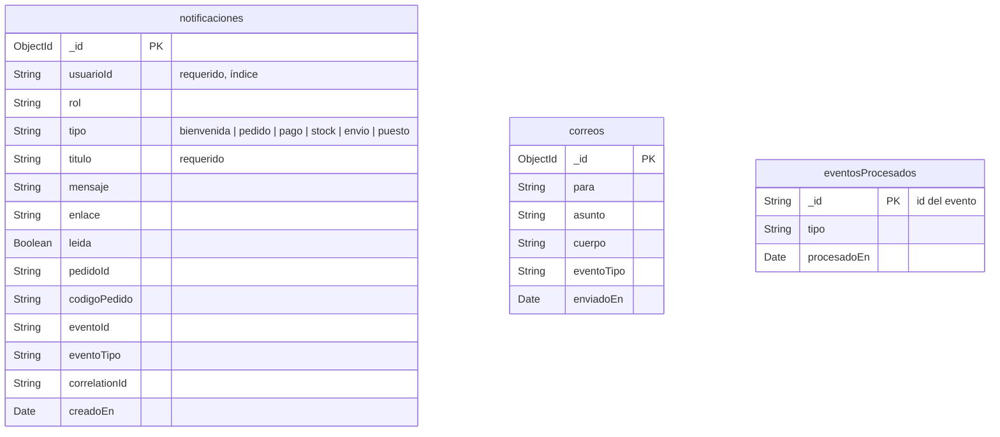

# notificaciones — modelo de datos

**Motor:** MongoDB 7 con Mongoose · **Contenedor:** `db-notificaciones` · **Modelo:** [`servicios/notificaciones/src/repositorio/modelos.js`](../../servicios/notificaciones/src/repositorio/modelos.js)

## Colección `notificaciones`

| Campo | Tipo | Restricciones | Descripción |
|---|---|---|---|
| `usuarioId` | String | requerido, índice | Destinatario (id lógico) |
| `rol` | String | — | Rol del destinatario |
| `tipo` | String | enum: `bienvenida`, `pedido`, `pago`, `stock`, `envio`, `puesto` | Para el ícono y el filtro |
| `titulo` | String | requerido | Título corto |
| `mensaje` | String | — | Texto de la notificación |
| `enlace` | String | — | Ruta a la que lleva (por ejemplo `/pedidos/:id`) |
| `leida` | Boolean | `false` por defecto | Estado de lectura |
| `pedidoId` / `codigoPedido` | String | — | Pedido relacionado |
| `eventoId` / `eventoTipo` / `correlationId` | String | — | Evento de RabbitMQ que la originó |
| `creadoEn` | Date | `Date.now` | Fecha |

**Índice compuesto:** `{ usuarioId: 1, creadoEn: -1 }` para listar la campana del usuario de la más reciente a la más antigua.

## Colección `correos`

Correo **simulado**: en vez de enviarlo, se guarda el correo que se habría enviado (destinatario, asunto y cuerpo).

## Colección `eventosProcesados`

Ids de eventos ya procesados para que el consumidor sea idempotente.

## Justificación del motor

Cada notificación es un documento independiente que se escribe una vez y se lee por usuario. No hay relaciones ni transacciones entre notificaciones, y el contenido varía según el tipo de evento. MongoDB encaja sin esquema rígido.

## Eventos

Consume `usuario.registrado`, `vendedor.aprobado`, `vendedor.suspendido`, `pedido.creado`, `pago.aprobado`, `pago.rechazado`, `pedido.estado_cambiado` e `inventario.stock_bajo` en la cola `notificaciones.eventos`. Publica `notificacion.enviada` (lo consume pedidos-pagos para la traza) y empuja cada notificación al navegador por **SSE** (`GET /notificaciones/stream`).
