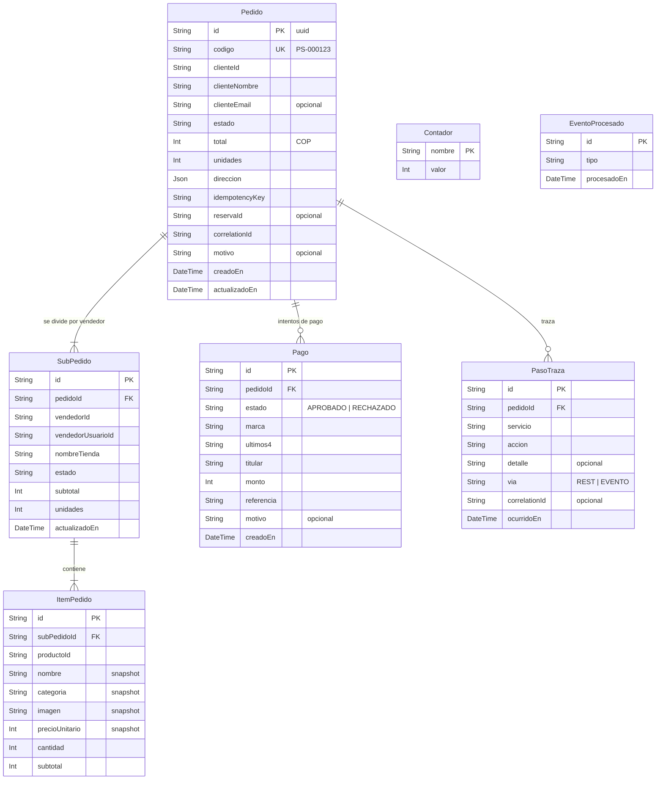

# pedidos-pagos — modelo de datos

**Motor:** PostgreSQL 16 con Prisma 6 · **Contenedor:** `db-pedidos` · **Esquema:** [`servicios/pedidos-pagos/prisma/schema.prisma`](../../servicios/pedidos-pagos/prisma/schema.prisma)

## Pedido

| Campo | Tipo | Restricciones | Descripción |
|---|---|---|---|
| `id` | String | PK | Identificador |
| `codigo` | String | único | Código legible `PS-000123`, sale de `Contador` |
| `clienteId` / `clienteNombre` / `clienteEmail` | String | `clienteId` con índice | Datos del cliente tomados del JWT |
| `estado` | String | requerido | `PENDIENTE_PAGO`, `PAGADO`, `PAGO_RECHAZADO`, `CANCELADO`, `RECHAZADO_SIN_STOCK` o `COMPLETADO` |
| `total` / `unidades` | Int | requeridos | Totales en COP enteros |
| `direccion` | Json | requerido | Quién recibe, teléfono, ciudad, dirección e indicaciones |
| `idempotencyKey` | String | único junto con `clienteId` | Si el cliente reintenta el checkout, recibe el mismo pedido (ADR-08) |
| `reservaId` | String | opcional | Reserva creada en inventario |
| `correlationId` | String | requerido | Para seguir la compra en los logs |

## SubPedido e ItemPedido

Un pedido con productos de tres puestos genera tres sub-pedidos. Cada vendedor ve y avanza **solo el suyo** (`PAGADO → PREPARANDO → ENVIADO → ENTREGADO`). `ItemPedido` guarda un **snapshot** de nombre, categoría, imagen y precio al momento de comprar: si el vendedor cambia el precio después, el pedido no cambia.

## Pago

Guarda cada intento de pago. **Nunca** se guarda el número completo de la tarjeta ni el CVV: solo `marca` y `ultimos4` (ADR-15).

## PasoTraza

Cada paso de la saga con su servicio, si fue REST o evento y su `correlationId`. Es lo que muestra la **Traza del pedido** en la interfaz.

## Contador y EventoProcesado

`Contador` genera el consecutivo de `codigo` (arranca en 123 en la demo). `EventoProcesado` hace idempotente al consumidor.

## Justificación del motor

El pedido es dinero: varias tablas relacionadas que se crean juntas (pedido, sub-pedidos, ítems y traza en una sola escritura anidada de Prisma, que es atómica), con unicidad `(clienteId, idempotencyKey)`. Cada cambio de estado (pedido, pago y paso de traza) corre en `prisma.$transaction`. Eso es exactamente lo que da PostgreSQL.

## Eventos

Publica `pedido.creado`, `pago.aprobado`, `pago.rechazado` y `pedido.estado_cambiado`. Consume `reserva.confirmada`, `reserva.liberada` y `notificacion.enviada` en la cola `pedidos.traza` (solo alimentan la traza).
