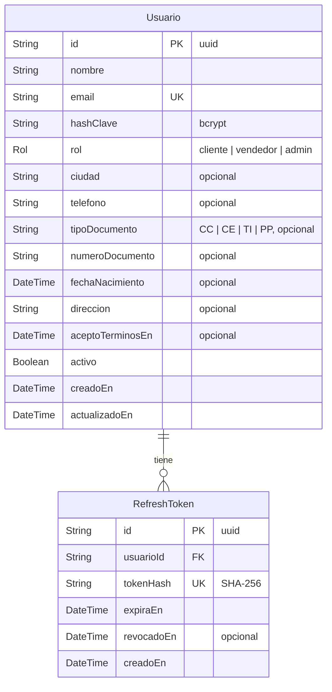

# usuarios — modelo de datos

**Motor:** PostgreSQL 16 con Prisma 6 · **Contenedor:** `db-usuarios` · **Esquema:** [`servicios/usuarios/prisma/schema.prisma`](../../servicios/usuarios/prisma/schema.prisma)

## Usuario

| Campo | Tipo | Restricciones | Descripción |
|---|---|---|---|
| `id` | String | PK, uuid por defecto | Identificador que viaja en el JWT como `sub` |
| `nombre` | String | requerido | Nombre visible |
| `email` | String | único | Correo con el que se inicia sesión |
| `hashClave` | String | requerido | Hash bcrypt. La clave nunca se guarda en texto plano |
| `rol` | enum `Rol` | `cliente` por defecto | `cliente`, `vendedor` o `admin` |
| `ciudad` | String | opcional | Ciudad del usuario |
| `telefono` | String | opcional, 7 a 15 dígitos | Celular de contacto |
| `tipoDocumento` | String | opcional: `CC`, `CE`, `TI` o `PP` | Tipo de documento de identidad |
| `numeroDocumento` | String | opcional, 5 a 15 letras o números | Número de documento |
| `fechaNacimiento` | DateTime | opcional; el registro exige mayoría de edad | Fecha de nacimiento |
| `direccion` | String | opcional, 5 a 120 caracteres | Dirección de entrega (cliente) o del negocio (vendedor) |
| `aceptoTerminosEn` | DateTime | opcional | Momento en que aceptó los términos y el tratamiento de datos |
| `activo` | Boolean | `true` por defecto | Permite desactivar cuentas |
| `creadoEn` / `actualizadoEn` | DateTime | automáticos | Auditoría |

## RefreshToken

| Campo | Tipo | Restricciones | Descripción |
|---|---|---|---|
| `id` | String | PK | Identificador |
| `usuarioId` | String | FK → `Usuario.id`, borrado en cascada, índice | Dueño de la sesión |
| `tokenHash` | String | único | Hash SHA-256 del refresh token. El token real solo lo tiene el navegador |
| `expiraEn` | DateTime | requerido | 7 días después de emitido |
| `revocadoEn` | DateTime | opcional | Se llena al usarlo (es de un solo uso) o al cerrar sesión |

## Justificación del motor

La identidad necesita unicidad garantizada (`email`, `tokenHash`), relaciones (`Usuario` → `RefreshToken`) y borrado en cascada. Es un modelo relacional estable, por eso PostgreSQL.

## Eventos

Publica `usuario.registrado` (lo consume notificaciones para el mensaje de bienvenida). No consume eventos.
