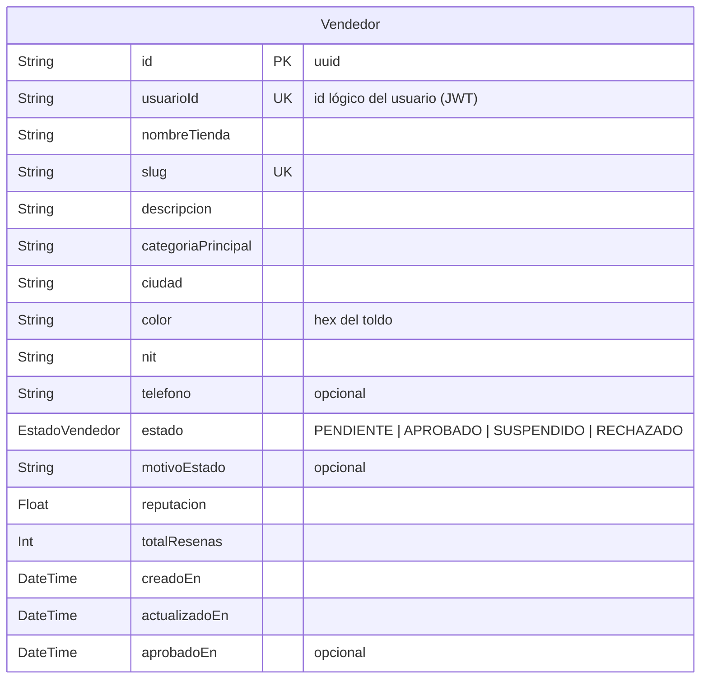

# vendedores — modelo de datos

**Motor:** PostgreSQL 16 con Prisma 6 · **Contenedor:** `db-vendedores` · **Esquema:** [`servicios/vendedores/prisma/schema.prisma`](../../servicios/vendedores/prisma/schema.prisma)

## Vendedor

| Campo | Tipo | Restricciones | Descripción |
|---|---|---|---|
| `id` | String | PK, uuid | Identificador del puesto (`vendedorId` en los demás servicios) |
| `usuarioId` | String | único | Usuario dueño del puesto. Sale del JWT, **no** es FK a otra base |
| `nombreTienda` | String | requerido | Nombre del puesto |
| `slug` | String | único | Nombre en URL |
| `descripcion` | String | `""` por defecto | Texto del puesto |
| `categoriaPrincipal` | String | requerido | `tecnologia`, `bicicletas`, `ropa`, `hogar`, `artesanias`, `papeleria` o `deportes` |
| `ciudad` | String | requerido | Ciudad del puesto |
| `color` | String | `#E4572E` por defecto | Color del toldo en la interfaz |
| `nit` | String | requerido | NIT del vendedor. Es opcional en la solicitud: si no llega, el servicio genera uno de demostración |
| `telefono` | String | opcional | Contacto |
| `estado` | enum | `PENDIENTE` por defecto, índice | Lo cambia el admin |
| `motivoEstado` | String | opcional | Motivo de rechazo o suspensión |
| `reputacion` / `totalResenas` | Float / Int | 0 por defecto | Datos de demostración |
| `aprobadoEn` | DateTime | opcional | Fecha de aprobación |

## Justificación del motor

Es un registro con una máquina de estados (`PENDIENTE → APROBADO / RECHAZADO`, `APROBADO ↔ SUSPENDIDO`) y unicidad (`usuarioId`, `slug`). PostgreSQL da esas restricciones y un enum nativo.

## Eventos

Publica `vendedor.aprobado` y `vendedor.suspendido` (los consumen catalogo y notificaciones). No consume eventos. Catalogo le pregunta por REST interno si un vendedor está aprobado antes de dejarlo publicar.
